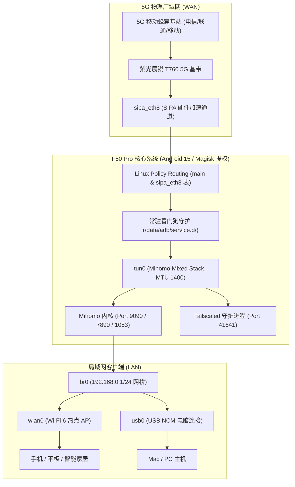

# 中兴 F50 Pro (MU3356) macOS 全能玩机工具箱 & 方案B透明软路由

<p align="center">
  
  
  
  
  
  
  
  
</p>

专为 **中兴 F50 Pro 5G 随身 WiFi (MU3356, 紫光展锐 Unisoc T760 芯片, Android 15)** 深度定制的 macOS 平台免驱一键刷机、提权、透明代理（Mihomo）、异地组网（Tailscale）与出厂救砖全套解决方案。

彻底解决 Mac 用户没有 Windows SPD 刷机驱动、随身 WiFi 无触摸屏无法点 Root 授权、Android 15 开机后台被杀、冷启动 5G 基带网络不同步导致的 TUN 路由崩溃，以及默认巨帧 MTU 限速等一系列棘手问题。

---

## 🌟 核心亮点与痛点攻坚

1. **⚡ macOS 原生 BootROM 芯片级免驱直刷**：
   - 内置编译好的通用架构（Universal 2）底层通信工具 `spd_dump_mac`，原生支持 Apple Silicon (M1/M2/M3/M4) 与 Intel Mac。
   - 彻底摆脱 Windows 复杂的 SPD 端口驱动与签名限制，插上 Type-C 即可直连芯片底层。
2. **🔑 底层永久 Root 与免密免弹窗提权**：
   - 针对随身 WiFi 无屏幕、弹出的 Magisk 授权窗口无法触摸点击的死局，定制 `init_boot` 补丁，在引导阶段直接注入 SQLite 底层权限（UID 2000 永久放行），ADB 免交互秒获最高权限。
3. **🛡️ 独家 Android 15 SIGHUP 免疫与高可用看门狗**：
   - 攻克 Android 15 init 进程组销毁时向下派发 `SIGHUP` 强杀后台进程的系统特性（使用 `( trap '' HUP ... ) &` 子 Shell 守护）。
   - 标准化接入 Magisk `service.d` 晚期自启机制（`/data/adb/service.d/mihomo_autostart.sh`）。
4. **⏱️ 独家 5G 基带冷启动时序对齐探针**：
   - F50 Pro 开机第 1 秒物理网卡 `sipa_eth8` 虽已创建，但运营商蜂窝 IP 需等待 15~25 秒才完成分配。本看门狗采用精准状态探针，杜绝了提前拉起软路由导致 `TUN route: network unreachable` 的断网 Bug。
   - 常驻看门狗每 15 秒双重健康检查（同时探测 `pidof mihomo` 和 `ip link show tun0`），掉线 1 秒无感拉起。
5. **🚀 100 Mbps 满血网速调优**：
   - 修复官方 TUN 默认 MTU 9000 巨帧被 5G 基带静默丢弃导致的严重卡顿。
   - 调优为 `MTU 1400` + 用户态高性能栈 `stack: mixed` (GVisor) + `TCPMSS --clamp-mss-to-pmtu`，实测下载吞吐直接跑满 100Mbps 蜂窝物理带宽。
6. **🌐 零配置 Web 控制面板**：
   - 内置 MetaCubeXD Web 资源（端口 9090），预置配置免输后端与空密钥，双击一键呼出控制面板。
7. **🔒 Tailscale 异地互联 & 出口节点**：
   - 一键开启后台并宣告内网子网（`192.168.0.0/24`），出差在外随时访问家中的 F50 Pro 与局域网设备。
8. **🚑 100% 芯片级全量物理备份与救砖**：
   - 一键全量备份整机 6.2GB 芯片物理镜像（包含关键基带 NVRAM、`prodnv` 唯一 IMEI 分区、`super` 系统分区），即使设备变砖卡标也能通过硬件 BootROM 一键满血复活。

---

## 🏗️ 架构拓扑图



---

## 📁 目录结构

```text
中兴F50Pro_macOS一键工具包_shuangye/
├── 【方案B】软路由与穿透管理中心.command  # 🌟 方案B核心总控（自启/Mihomo/Tailscale/订阅管理）
├── F50Pro一键工具箱.command               # 🌟 官方综合工具箱（Root/UFI增强后台/网络急救）
├── 【一键全量备份固件】F50Pro.command       # 🛡️ 芯片级全量物理分区备份（生成完整镜像）
├── 【一键底层救砖还原】F50Pro.command       # 🚑 100% 底层免开机救砖回滚
├── README.md                              # 本说明文档
├── LICENSE                                # MIT 开源协议
├── 【重要交接文档】F50Pro方案B软路由与救砖全解.md # 📖 深度技术架构与排障完全手册
├── bin/                                   # 核心固件与工具依赖（无需额外配置）
│   ├── adb                                # macOS 通用架构 ADB
│   ├── spd_dump_mac                       # macOS 通用架构展锐 BootROM 刷机工具
│   ├── tos.bin                            # TrustOS 补丁（Root + 无线ADB）
│   ├── magisk.img                         # Magisk init_boot 补丁（免密提权）
│   ├── UFI-TOOLS.apk                      # 增强 Web 管理后台 (2333 端口)
│   └── ...                                # 引导加载与签名绕过补丁
└── scheme_b/                              # 方案B核心资产库
    ├── mihomo                             # ARM64 Mihomo (Clash.Meta) 内核
    ├── tailscale / tailscaled             # ARM64 Tailscale 异地组网套件
    ├── config.yaml                        # 针对 5G 调优的透明代理配置 (MTU 1400)
    ├── autorun.sh                         # 开机自启看门狗 (基带 IP 探针 + 进程/TUN 守护)
    ├── start.sh / stop.sh / status.sh     # 防火墙与服务控制脚本
    ├── merge_sub.py                       # 智能订阅合并器（保留 5G 软路由优化项）
    └── ui/                                # MetaCubeXD WebUI 面板 (已预置免填配置)
```

---

## 🚀 极速上手指南

### 1. 下载工具包
前往 [Releases 页面](../../releases) 下载已打包好的 `中兴F50Pro_macOS一键工具包_shuangye.zip` 并解压。

### 2. 部署方案B透明软路由（推荐）
1. 双击运行 **`【方案B】软路由与穿透管理中心.command`**。
2. 输入 **`1`**（一键刷入开机自启补丁）。
3. 按照提示输入您的 Mac 开机密码，然后将断开电源的 F50 Pro 插入 Mac USB 口。
4. 工具会自动完成 BootROM 刷入并引导开机；开机后脚本会**自动连续部署方案B全套组件与开机自启看门狗**！
5. 在主菜单输入 **`5`**，粘贴您的 Clash 机场订阅链接（智能合并节点与分流规则）。
6. 在主菜单输入 **`3`**，浏览器将直接打开 Web 控制面板 (`http://192.168.0.1:9090/ui`)。

### 3. 日常使用
- 以后出门只需将 F50 Pro 插在任何充电宝或车充上，开机 20 秒后自动上线透明代理，无需再次连接电脑！
- 所有连入 F50 Pro Wi-Fi 的手机、平板、电脑均无感科学上网，尽享 100Mbps 满血带宽。

---

## 🚑 底层全量备份与终极救砖

在对设备进行折腾前，强烈建议执行一次全量备份：
1. 运行 **`【一键全量备份固件】F50Pro.command`**，拔插一次设备，工具会自动克隆全部硬件芯片分区至本地。
2. 若设备意外变砖（无法开机、卡开机中兴 Logo），随时运行 **`【一键底层救砖还原】F50Pro.command`**，拔插设备即可在 30 秒内原样回写恢复出厂！

> **⚠️ 隐私与安全提示**：备份生成的 `backup/` 目录中包含您设备的专属物理 IMEI 号和基带校准数据，**切勿上传到公共网络或 GitHub**。本项目 `.gitignore` 已默认严格忽略该目录。

---

## 🛡️ 严正声明：永久开源免费 · 严禁商用倒卖

> **⚠️ 致所有使用者（尤其是从电商平台看到本项目的用户）：**
> 
> 1. **完全免费**：本项目为作者 `shuangye` 在业余时间攻坚原创的公益开源成果，代码、固件补丁与全套工具包**永久 100% 免费**向所有人开放。
> 2. **打击倒卖欺诈**：任何个人、商家在**闲鱼、淘宝、拼多多、微信小程序、QQ群、B站**等平台将本项目打包售卖、付费加群提供、或以此提供“有偿远程代刷服务”的行为，均属于**侵权非法倒卖与欺诈消费**！
> 3. **维权举报**：若您系花钱购得本工具，您已遭遇欺诈，请立即向平台投诉举报卖家诈骗并申请全额退款。
> 4. **防伪认准**：请认准作者唯一官方开源发布地址：`https://github.com/shuangye/zte-f50pro-macos-toolkit`。任何篡改作者署名、二次打包加壳的“魔改版”可能植入后门木马，请切勿信任。

---

## ⚖️ 开源协议与致谢

- **作者 / 架构设计**: [shuangye](https://github.com/shuangye)
- **开源协议**: 本项目遵循带有【反商业倒卖附加条款】的 [MIT License](LICENSE)。任何二次分发均必须严格保留原作者署名与开源仓库地址，且不得用于任何商业营利。
- **项目致谢**:
  - [spreadtrum_flash](https://github.com/handsomehack/spreadtrum_flash) 提供紫光展锐 BootROM 芯片级刷机通信基础
  - [kanoqwq/UFI-TOOLS](https://github.com/kanoqwq/ufi-tools) 随身 WiFi 工具生态启发
  - [MetaCubeX/mihomo](https://github.com/MetaCubeX/mihomo) 优秀的透明软路由内核
  - [Tailscale](https://tailscale.com) 优秀的异地组网网格网络

---

### 免责声明
本工具仅供网络技术研究与个人随身 WiFi 优化交流使用。请合法合规使用网络。作者不对因第三方不当操作或硬件老化导致的设备损坏承担连带责任。

