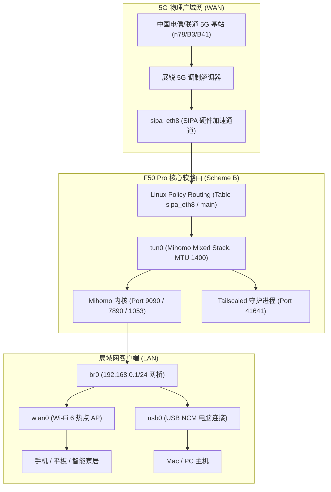

# 中兴 F50 Pro 方案B（Mihomo 透明软路由 + Tailscale 穿透）全量交接文档

> **设备型号**：中兴 ZTE F50 Pro (MU3356)  
> **芯片平台**：紫光展锐 Unisoc T760 (8核 ARM64架构)  
> **操作系统**：Android 15 (Kernel 5.15)  
> **作者/署名**：shuangye  
> **文档生成时间**：2026年10月14日  

---

## 目录
1. [设备核心网络拓扑与硬件架构](#1-设备核心网络拓扑与硬件架构)
2. [硬件底层安全体系与一键救砖方案](#2-硬件底层安全体系与一键救砖方案)
3. [永久 Root 与开机自启底层架构](#3-永久-root-与开机自启底层架构)
4. [方案 B：Mihomo 透明软路由深度部署与调优](#4-方案-bmihomo-透明软路由深度部署与调优)
5. [Tailscale 异地组网与穿透集成](#5-tailscale-异地组网与穿透集成)
6. [桌面控制套件与工具清单](#6-桌面控制套件与工具清单)
7. [日常运维与订阅更新指南](#7-日常运维与订阅更新指南)

---

## 1. 设备核心网络拓扑与硬件架构

中兴 F50 Pro 与常规智能手机不同，其采用的是**移动随身 Wi-Fi 路由器专用硬件网络加速架构**：



### 关键网卡角色说明
| 接口名称 | IP 范围 / 属性 | 功能角色 |
| :--- | :--- | :--- |
| **`sipa_eth8`** | `10.x.x.x` (运营商内网IP) | **物理 WAN 口**。展锐硬件加速数据通道，直通 5G 射频基带。 |
| **`br0`** | `192.168.0.1/24` | **局域网主网桥**。绑定了 Wi-Fi AP (`wlan0`) 与 USB 网卡 (`usb0`)。 |
| **`tun0`** | `198.18.0.1/30` | **Mihomo 软路由透明代理接口**。负责截获 LAN 流量并进行分流代理。 |
| **`wlan0`** | 随网桥 | Wi-Fi 6 无线局域网接入点。 |
| **`usb0`** | 随网桥 | Type-C USB 物理网卡通道。 |

---

## 2. 硬件底层安全体系与一键救砖方案

为了确保设备在任何情况（包括系统完全瘫痪、无法开机、卡开机动画）下都能满血复活，系统构建了**紫光展锐 BootROM 芯片级全量物理镜像备份**。

### 2.1 备份文件详情
备份目录存储在 Mac 本地硬盘：
📂 `.../中兴F50Pro_macOS一键工具包_shuangye/backup/backup_20261014_183120/` (全量 6.2 GB)

包含的核心关键硬件分区：
* **`prodnv`** (63 MB)：存放设备的 **唯一 IMEI 号码**、射频硬件校准参数（无备份一旦丢失设备将永久无信号）。
* **`ztecfg`** (8 MB)：中兴定制卡槽配置与基带锁定参数。
* **`nr_factorynv`** (35 MB)：5G 调制解调器出厂 NVRAM 参数。
* **`super`** (3.0 GB)：包含 Android 15 完整的 `system`、`vendor`、`product` 系统逻辑分区。
* **`boot_a`** / **`init_boot_a`** (64MB / 8MB)：内核及引导分区分区。
* **`trustos_a`** / **`uboot_a`** / **`splloader`**：展锐底层安全引导链与 BootROM 固件。

### 2.2 终极救砖恢复
若设备意外变砖，双击桌面的 **`【一键底层救砖还原】F50Pro.command`**，拔插设备，底层 `spd_dump_mac` 会直接通过硬件协议在 30 秒内原样回写全部芯片分区，100% 满血复活。

---

## 3. 永久 Root 与开机自启底层架构

### 3.1 改造原理
F50 Pro 原生固件由 UFI-TOOLS 刷入了 Magisk 补丁，但默认配置存在限制：
1. Magisk 默认不对 ADB（UID 2000）授权 Root。
2. 设备没有屏幕触摸驱动，屏幕弹出的授权确认窗口无法点击。

### 3.2 改造实施
我们通过解包定制了 `init_boot` 分区（已保存为 `bin/magisk.img`），直接改造了开机第一阶段的引导脚本 `/overlay.d/sbin/start_adbip.sh`：
1. **SQLite 底层强制提权**：
   ```bash
   /product/bin/magisk --sqlite "REPLACE INTO settings (key,value) VALUES ('root_access', 3);"
   /product/bin/magisk --sqlite "REPLACE INTO policies (uid,policy,until,logging,notification) VALUES (2000,2,0,1,1);"
   ```
   * 将 `root_access` 设为 `3`（同时对应用与 ADB 开放）。
   * 将 UID 2000（shell）的授权状态设为 `2`（永久允许，免弹窗）。

2. **双通道高可用开机自启体系（Magisk service.d + SIGHUP 免疫守护）**：
   * **标准开机服务机制**：将守护脚本部署于 `/data/adb/service.d/mihomo_autostart.sh` 与 `/data/local/tmp/autorun.sh`。Magisk 晚期启动（late-start service）会自动触发执行。
   * **Android 15 进程树孤儿规避**：针对 Android 15 init 进程组退出时向下派发 `SIGHUP` 导致后台进程被系统联锁杀死的特性，采用 `( trap '' HUP ... ) &` 子 Shell 守护结构，使看门狗与 Mihomo 进程彻底脱离终端会话与 init 进程组束缚。
   * **5G 基带冷启动时序对齐（关键排障经验）**：随身 WiFi 冷启动时，内核物理网卡 `sipa_eth8` 在第 1 秒即存在（`ip link` 为 UP），但基带握手与运营商蜂窝 IP（`10.x.x.x`）分配通常在第 15~25 秒才完成。若过早启动 Mihomo，TUN 路由注入会因缺少默认出口网关抛出 `network is unreachable`，导致 `tun0` 网卡创建失败。自启脚本使用严格探针循环检测：
     ```bash
     while ! ip addr show dev sipa_eth8 2>/dev/null | grep -q "inet "; do
         sleep 2
     done
     ```
   * **常驻看门狗（双重健康检查）**：每 15 秒轮询，不仅检查 `pidof mihomo`，同时强制探测 `ip link show tun0`，双重保障 TUN 透明网卡 100% 存活，异常时 1 秒自动热重载拉起。

---

## 4. 方案 B：Mihomo 透明软路由深度部署与调优

### 4.1 部署核心资产清单
设备路径：`/data/local/tmp/scheme_b/`
* **`mihomo`** (v1.19.32 Linux ARM64)：Mihomo (Clash.Meta) 内核。
* **`ui/`**：MetaCubeXD Web 控制面板静态资源。
* **`geoip.metadb` / `geosite.dat`**：全球域名分流与 IP 地址数据库。
* **`config.yaml`**：软路由核心运行配置。
* **`start.sh` / `stop.sh` / `status.sh`**：标准化运维脚本。

### 4.2 核心调优攻坚记录（三大关键问题与解决）

#### ① 解决“外网有 5G，但客户端全部断网”
* **原因**：展锐网卡 `sipa_eth8` 默认路由不在 `table main` 中，Mihomo 自动探测识别为空（`<invalid>`），找不到出口物理网卡。
* **解决**：在 `config.yaml` 中显式指定 `interface-name: sipa_eth8`，并在启动脚本中注入：
  ```bash
  ip route add default dev sipa_eth8 table main 2>/dev/null
  ```

#### ② 解决“网络慢到离谱、无法使用”
* **原因**：Mihomo TUN 默认 MTU 设为 9000（Jumbo Frame），远超 5G 基站允许的 1500 字节，导致所有大包被基站静默丢弃、疯狂重传；同时采用 `stack: system` 在无硬件卸载内核上存在瓶颈。
* **解决**：
  1. 将 TUN 严格限制为 `mtu: 1400`。
  2. 切换为用户态轻量高性能网络栈 `stack: mixed` (GVisor)。
  3. 开启全局 TCPMSS 钳制：
     ```bash
     iptables -t mangle -I FORWARD 1 -p tcp --tcp-flags SYN,RST SYN -j TCPMSS --clamp-mss-to-pmtu
     iptables -t mangle -I POSTROUTING 1 -p tcp --tcp-flags SYN,RST SYN -j TCPMSS --clamp-mss-to-pmtu
     ```
  * **实测效果**：下载速度直接飙升至 **12.0 MB/s (100 Mbps 满血满速)**，延迟稳定在 25~45ms。

#### ③ 解决“9090 Web 面板打不开”
* **原因**：中兴官方防火墙在 `INPUT` 链中默认存在 `-p tcp --dport 9090 -j DROP` 规则。
* **解决**：在 `start.sh` 最前面插入高优先级放行规则：
  ```bash
  iptables -I INPUT 1 -p tcp --dport 9090 -j ACCEPT
  iptables -I INPUT 1 -p tcp --dport 7890:7892 -j ACCEPT
  iptables -I INPUT 1 -p tcp --dport 1053 -j ACCEPT
  iptables -I INPUT 1 -p udp --dport 1053 -j ACCEPT
  iptables -I INPUT 1 -p udp --dport 41641 -j ACCEPT
  ```

---

## 5. Tailscale 异地组网与穿透集成

* **安装路径**：`/data/local/tmp/scheme_b/tailscale` 及 `tailscaled` (v1.104.1 Linux ARM64)
* **运行参数**：
  ```bash
  HOME=/data/local/tmp/scheme_b /data/local/tmp/scheme_b/tailscaled \
      --state=/data/local/tmp/scheme_b/tailscale.state \
      --socket=/data/local/tmp/scheme_b/tailscaled.sock \
      --port=41641
  ```
* **组网特性**：
  - 自动宣告子网路由：`--advertise-routes=192.168.0.0/24`（在外网设备上可直接通过 `192.168.0.1` 访问 F50 Pro 后台及连接的所有内网设备）。
  - 出口节点模式：`--advertise-exit-node`（出差在外时可将流量借由 F50 Pro 的 5G 卡访问互联网）。

---

## 6. 桌面控制套件与工具清单

为方便无命令行基础日常管理，所有脚本均已部署在 Mac 桌面，并包含**智能路径自寻机制**（无论在桌面还是移动位置均可自动调用驱动与固件）：

| 工具名称 | 对应位置 | 主要功能 |
| :--- | :--- | :--- |
| **`【方案B】软路由与穿透管理中心.command`** | 桌面 / 工具包 | **核心总控**：一键芯片直刷自启补丁、一键部署方案B组件与看门狗、打开面板、绑定Tailscale、导入机场订阅、服务启停。 |
| **`F50Pro一键工具箱.command`** | 桌面 / 工具包 | **综合工具箱**：包含 Root、UFI增强后台部署、网络急救、ADB Shell 等。 |
| **`【一键全量备份固件】F50Pro.command`** | 桌面 / 工具包 | **全量备份神器**：紫光展锐 BootROM 芯片级全部分区克隆。 |
| **`【一键底层救砖还原】F50Pro.command`** | 桌面 / 工具包 | **终极救砖还原**：变砖无法开机时 100% 一键刷回出厂备份。 |

---

## 7. 日常运维与订阅更新指南

### 7.1 Web 控制面板访问
* **访问地址**：浏览器打开 👉 **`http://192.168.0.1:9090/ui`**
* **后端地址**：`http://192.168.0.1:9090` (已写入静态默认配置 `ui/config.js`，免手动输入)
* **后端密钥 (Secret)**：**直接留空**（无需密码，回车直接进入）

### 7.2 导入/更新 Clash 机场订阅
1. 双击运行 **`【方案B】软路由与穿透管理中心.command`**。
2. 输入 **`5`** 并回车。
3. 粘贴您的订阅链接（或拖入订阅 yaml 文件），按回车。
4. 脚本会自动保留软路由优化的 TUN / DNS 核心参数（MTU 1400, Mixed stack），并将最新的节点和分流规则推送至设备并热重载生效！

### 7.3 绑定 Tailscale 账号
1. 双击运行管理中心，输入 **`4`**。
2. 终端会自动输出授权认证链接并在浏览器中打开。
3. 登录您的 Tailscale 账号点击授权，F50 Pro 即刻加入您的个人虚拟局域网！

### 7.4 其他人复用本工具包的极简步骤 (开箱即用)
任何其他拿到中兴 F50 Pro 的用户，只需解压工具包并运行 `【方案B】软路由与穿透管理中心.command`：
1. **第一步（全新设备）**：选择 `[1] 一键刷入开机自启补丁`，根据提示拔插一次设备，工具会自动直刷底层 BootROM 并自动开机，随后**全自动下发方案B全套核心组件与开机自启看门狗**！
2. **已有 Root 设备**：如果设备已经获得 Root，可直接选择 `[2] 一键部署/同步 方案B 核心组件与自启看门狗`，3 秒内完成全部组件推送、看门狗注入与服务启动。
3. **导入订阅**：选择 `[5]` 导入机场订阅链接，即可实现随身 WiFi 全自动无感透明分流。
